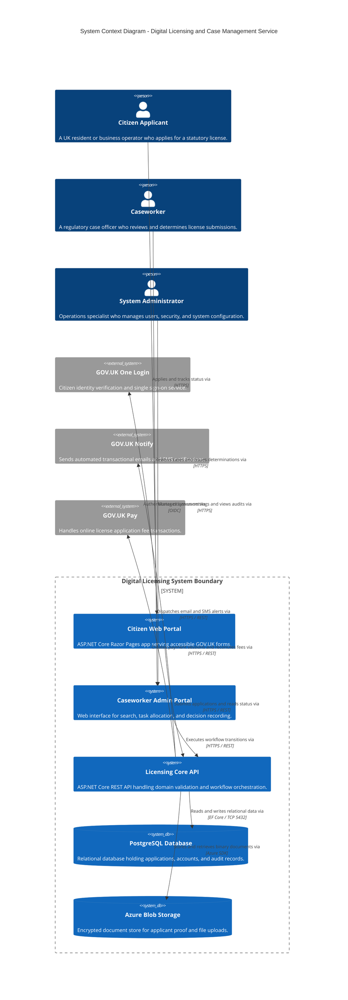

# Digital Licensing and Case Management Service — Architecture

## System Diagram



## Tech Stack

- **Runtime & Language:** .NET 9 / C# 13
- **Web Frontend:** ASP.NET Core Razor Pages with `GovUk.Frontend.AspNetCore` (GOV.UK Design System v5)
- **API Framework:** ASP.NET Core Web API with OpenAPI / Scalar documentation
- **Relational Database:** PostgreSQL 16 on Azure Database for PostgreSQL Flexible Server
- **ORM & Migrations:** Entity Framework Core 9 (Npgsql provider)
- **Document Storage:** Azure Blob Storage with customer-managed encryption keys
- **Identity & Auth:** OpenID Connect via GOV.UK One Login (citizens) and Microsoft Entra ID (staff)
- **External Integrations:** GOV.UK Pay REST API, GOV.UK Notify REST API
- **Cloud Infrastructure:** Azure App Service (Linux containers), Azure Key Vault, Azure Monitor

## Layers

The system follows a clean modular layered architecture:

1. **Presentation Layer:**
   - Citizen Web Portal (`src/Hippo.Licensing.Web`): Server-side Razor Pages implementing GOV.UK Design System patterns.
   - Caseworker Admin Portal (`src/Hippo.Licensing.Admin`): Casework management views and administrative dashboards.
2. **Application Layer:**
   - MediatR command and query handlers orchestrating use cases, input validation (FluentValidation), and event publishing.
   - Module interfaces enforcing logical boundaries between Applications, Casework, and Payments.
3. **Domain Layer:**
   - Pure domain models, value objects, domain events, and business invariants without external dependencies.
4. **Infrastructure Layer:**
   - Entity Framework Core DbContext implementations, Npgsql database mappings, and database migrations.
   - External service clients: GOV.UK One Login, GOV.UK Notify, GOV.UK Pay, and Azure Blob Storage client wrappers.

## Key Patterns

- **Modular Monolith:** Strict compile-time boundary separation between functional modules inside a single deployable unit.
- **CQRS (Command Query Responsibility Segregation):** Clear separation between write commands (state transitions) and read queries.
- **Mediator Pattern:** In-process decoupling of HTTP endpoint handlers from application use cases using MediatR.
- **Domain-Driven Design (DDD) Aggregates:** Explicit aggregate roots (`Application`, `License`, `CaseRecord`) that enforce business rules.
- **Outbox Pattern:** Reliable asynchronous dispatch of integration events (e.g. notifications) after atomic database commits.

## Source code layout

```text
hippo-agents-test10/
├── .memory/                          # Project memory and architecture governance
├── src/
│   ├── Hippo.Licensing.Web/          # Citizen web portal (Razor Pages + GDS)
│   ├── Hippo.Licensing.Admin/        # Caseworker admin portal
│   ├── Hippo.Licensing.Core/         # Application use cases, commands, queries
│   ├── Hippo.Licensing.Domain/       # Domain aggregates, entities, rules
│   └── Hippo.Licensing.Infrastructure/# EF Core, PostgreSQL, Azure Blob, External APIs
├── tests/
│   ├── Hippo.Licensing.UnitTests/    # Unit tests for domain and application logic
│   ├── Hippo.Licensing.IntegrationTests/ # Integration tests with Testcontainers
│   └── Hippo.Licensing.E2ETests/     # Playwright end-to-end browser tests
└── Hippo.Licensing.sln               # .NET Solution file
```

## Data Flow

1. **Citizen Application Flow:**
   - Citizen authenticates through GOV.UK One Login and fills the application form in the Citizen Web Portal.
   - Portal sends commands to the Application layer.
   - Core API stores application data in PostgreSQL and saves binary evidence into Azure Blob Storage.
   - Citizen pays required fee through GOV.UK Pay.
   - Application emits `ApplicationSubmittedEvent`, triggering an automated confirmation email via GOV.UK Notify.
2. **Caseworker Review Flow:**
   - Caseworker signs in via Microsoft Entra ID to access the Caseworker Admin Portal.
   - Caseworker claims an unassigned application from the triage queue.
   - Caseworker reviews submitted evidence via secure short-lived SAS URLs.
   - Caseworker records approval or refusal; system updates license status and dispatches notification to applicant.

## Cross-Cutting Concerns

- **Security & Authorization:** Role-based access control (RBAC) separating applicants, caseworkers, and administrators.
- **Audit Logging:** Structured audit events recorded in an append-only audit table for all sensitive state changes.
- **Observability:** OpenTelemetry instrumentation with distributed tracing, metrics, and structured logs forwarded to Azure Monitor.
- **Resilience:** Polly retry policies and circuit breakers on external HTTP calls (GOV.UK Pay, GOV.UK Notify).

## ADRs

<!-- adr-table:start -->
| ID | Title | Status | Date |
|----|-------|--------|------|
| [ADR-0001](decisions/ADR-0001-modular-monolith-architecture.md) | Adopt Modular Monolith Architecture | accepted | 2026-11-16 |
| [ADR-0002](decisions/ADR-0002-postgresql-azure-blob-storage.md) | Adopt PostgreSQL and Azure Blob Storage for Persistence | accepted | 2026-11-16 |
| [ADR-0003](decisions/ADR-0003-dual-identity-management.md) | Dual Identity Management via GOV.UK One Login and Microsoft Entra ID | accepted | 2026-11-16 |
<!-- adr-table:end -->

## Assumptions

<!-- assumption-list:start -->
- [ASSUME-0001: Use GOV.UK One Login for Citizen Identity Authentication](assumptions/ASSUME-0001-govuk-one-login.md)
- [ASSUME-0002: Cloud Hosting on Microsoft Azure UK South](assumptions/ASSUME-0002-azure-uk-south-hosting.md)
- [ASSUME-0003: Statutory Ten Working Day Casework Decision SLA](assumptions/ASSUME-0003-statutory-casework-sla.md)
<!-- assumption-list:end -->

The save_adr and save_assumption tools fill these lists. Do not edit between the markers.
